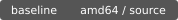

<p>
  
</p>

[](CHANGELOG.md)
[](COPYING)
[](profiles/README.md)
[](docs/status.md)

AmbiguOS is a Gentoo-based distribution with intent-mediated filesystem operations.
Packages are built from source. Creation requests are submitted to a local language
model before they are committed to disk.

This tree contains the userspace prototype, distribution configuration and an
experimental Portage overlay. No installation image is available. See
[status](docs/status.md) for the current scope.

## Requirements

* Python 3.11 or later
* GNU make for the development targets
* Ollama with `smollm2:135m` running locally for live inference
* An Ollama-supported GPU with at least 2 GiB of available VRAM for live inference
* Gentoo amd64 with Portage for overlay development

The userspace tools also run on other Linux distributions and macOS. They require
no third-party Python modules and do not replace the host's coreutils. Replay
and development tests do not require a GPU.

## Quick start

From the repository root:

```sh
make check
./bin/ambimk --replay examples/decisions/file.json --root ./var/root notes.txt
```

The replay creates `var/root/notes.txt`. Replay mode reads a recorded decision and
does not contact a model.

For live inference, start Ollama in another terminal, then run:

```sh
ollama pull smollm2:135m
./bin/ambimk --root ./var/root --pretend notes.txt
./bin/ambimk --root ./var/root notes.txt
```

Each invocation requests a new decision. A successful preview does not reserve its
result for a later invocation. `--pretend` prints the decision without creating the
root or its contents.

## Operation

`ambimk` sends the requested name, declared operation and optional context to the
configured model. The model returns a file, directory or deferred decision. The
executor checks the response and applies it beneath the selected root.

An explicit `--kind file` is evidence of intent. It is not a binding instruction.
The default model is small enough to run locally; additional context may change
its interpretation of otherwise identical requests. There is no decision cache.

```sh
./bin/ambimk --kind directory --context 'release notes' --root ./var/root notes
```

Existing paths are never replaced. Absolute paths, parent traversal and symlink
components are rejected. Model output is data and is never executed as a command.
The working root must be private to the invoking user; it is not a security
boundary against concurrent processes. Run without elevated privileges.

## Repository layout

| Path | Contents |
| --- | --- |
| `src/ambiguos/` | decision protocol and executor |
| `bin/` | development entry point |
| `etc/` | inference configuration example |
| `overlay/` | experimental Gentoo repository |
| `profiles/` | source-build configuration fragments |
| `docs/` | protocol, setup and development notes |
| `tests/` | protocol and filesystem regression tests |

The compiler toolchain remains under Portage control. Inference is confined to
creation requests submitted through `ambimk`; see [design](docs/design.md).

## Development

Run `make check` before submitting changes. Include the requested operation, model
identifier and returned decision when reporting an interpretation failure. Remove
private context from reports. See [CONTRIBUTING.md](CONTRIBUTING.md).

## License

Repository code and configuration are MIT licensed; see [COPYING](COPYING).
Gentoo packages and model weights retain their respective licenses. AmbiguOS is
an independent project and is not affiliated with Gentoo.
